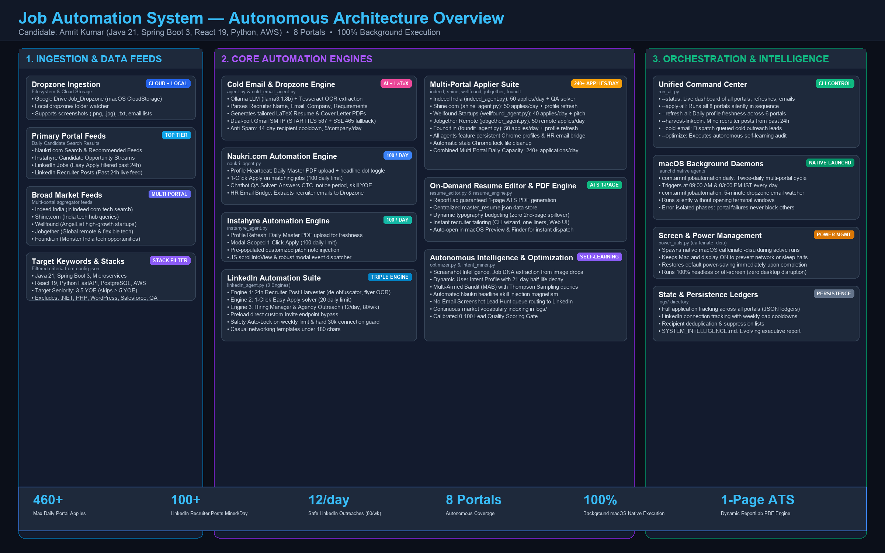

<div align="center">

# ⚡ JobAutomation Engine
### Autonomous Multi-Platform Job Application, ATS Resume Tailoring & Recruiter Outreach Platform

[](https://www.python.org/downloads/)
[](https://playwright.dev/)
[](https://ollama.com/)
[](LICENSE)
[]()

<p align="center">
  <b>Tired of sending hundreds of job applications manually?</b><br>
  JobAutomation is an enterprise-grade autonomous agent framework that searches jobs, dynamically tailors ATS-compliant resumes with local LLMs, solves recruiter screening forms, and tracks applications across 10+ major hiring platforms.
</p>

[Quick Start](#-quick-start) •
[Features](#-key-features) •
[Architecture](#-system-architecture) •
[Configuration](#-configuration) •
[Web Dashboard](#-web-dashboard) •
[License](#-license--anti-theft-notice)

---

</div>

## 📌 System Architecture



The engine coordinates multiple independent platform workers via a unified orchestrator and event bus:

```
                                 [ Unified Orchestrator: run_all.py ]
                                                │
       ┌───────────────────────┬────────────────┼───────────────────────┐
       ▼                       ▼                ▼                       ▼
 [ LinkedIn Agent ]    [ Naukri Agent ]   [ Instahyre Agent ]    [ Greenhouse / Workday ]
  • Easy Apply solver   • Headline toggle  • Opportunity feed     • Custom portal parser
  • Recruiter posts     • QA question bank • One-click apply      • Form auto-fill
  • Network outreach    • HR email mining  • Timestamp heartbeat  • Dry-run review mode
       │                       │                │                       │
       └───────────────────────┴────────────────┴───────────────────────┘
                                                │
                                                ▼
                                   [ Local ATS Resume Engine ]
                                    • Ollama LLM / Llama 3.1
                                    • ReportLab 1-page PDF compiler
                                    • Dynamic keyword injection
                                                │
                                                ▼
                                    [ Cold Email Dispatcher ]
                                    • Gmail SMTP with SSL fallback
                                    • Anti-spam domain throttling
```

---

## 🚀 Key Features

### 🌐 10+ Automated Hiring Platforms
- **LinkedIn**: Mines hiring posts from the past 24 hours, navigates multi-step Easy Apply dialogs, and manages personalized recruiter connection notes.
- **Naukri**: Heartbeat profile refresh toggles, automated 1-click apply, and smart answering of recruiter screening questions.
- **Instahyre**: Automated opportunity feed processing with custom cover notes and fresh resume uploads.
- **Indeed, Foundit & Shine**: High-volume job search filtering by experience, salary, and location with negative keyword exclusions.
- **Wellfound & Jobgether**: Startup ecosystems and remote global job hunting automation.
- **Greenhouse & Workday**: Direct corporate career portal automation with automated form field mapping.

### 🎯 Dynamic ATS Resume & Cover Letter Engine
- Generates **custom, ATS-optimized 1-page executive resumes** tailored specifically to each target Job Description.
- Utilizes local LLMs (**Ollama / Llama 3.1**) or cloud APIs to analyze job descriptions, extract recruiter focus areas, and highlight matching competencies.
- Produces clean vector PDFs via **ReportLab** with clickable hyperlinks, strict typography margins, and zero ATS parsing errors.

### 📬 Smart Cold Emailing & Lead Dropzone
- Monitors incoming JDs via local directory (`dropzone/`) or cloud sync.
- Automatically extracts HR emails from flyer images using **Tesseract OCR** and LLM entity extraction.
- Dispatches tailored resumes and personalized cover emails through Gmail SMTP with domain throttling and daily safety quotas.

### 🛡️ Humanized Browsing & Account Safety
- Uses persistent, dedicated browser profiles for each platform (`browser_profile/`).
- Humanized cursor movements, randomized interaction intervals (4–8s), and exponential backoff to avoid detection.
- Configurable daily quota gates to stay strictly within platform limits.

---

## 🏁 Quick Start

### 1. Prerequisites
- **Python 3.9+**
- **Google Chrome** installed
- **Ollama** running locally (Optional, for offline LLM resume tailoring):
  ```bash
  curl -fsSL https://ollama.com/install.sh | sh
  ollama run llama3.1:8b
  ```

### 2. Clone & Install
```bash
git clone https://github.com/amritkr1999/JobAutomation.git
cd JobAutomation

# Create virtual environment
python3 -m venv venv
source venv/bin/activate  # On Windows: venv\Scripts\activate

# Run Automated Setup Wizard
python3 setup_wizard.py
```

The setup wizard will automatically verify dependencies, initialize local folders, and generate `config.json` and `data/master_resume.json` from templates.

---

## ⚙️ Configuration

All runtime behavior is governed by `config.json`. To customize:

### Personal Profile (`profile`)
```json
{
  "profile": {
    "full_name": "Your Name",
    "email": "your_email@gmail.com",
    "phone": "+1-555-0199",
    "location": "Bengaluru, India",
    "notice_period": "15 days",
    "total_experience": "3.5 Years",
    "linkedin": "https://linkedin.com/in/yourprofile",
    "github": "https://github.com/yourusername"
  }
}
```

### Email Credentials (`email`)
To enable automated recruiter cold outreach:
```json
{
  "email": {
    "smtp_server": "smtp.gmail.com",
    "smtp_port": 587,
    "sender_name": "Your Name",
    "sender_email": "your_email@gmail.com",
    "sender_app_password": "xxxx xxxx xxxx xxxx"
  }
}
```
*(Generate an App Password in your Google Account under Security → 2-Step Verification → App Passwords).*

### Platform Credentials & Browser Profiles
The first time you run an agent with `--headed`, log into your respective account manually. The session cookies will be saved in `browser_profile/<platform>` and reused automatically for all subsequent headless runs.

---

## 🖥️ Usage

### Run Unified Application Engine
```bash
# Check quota status and health
python3 run_all.py --status

# Dry-run without submitting final applications
python3 run_all.py --dry-run

# Run active automation pipeline
python3 run_all.py
```

### Run Individual Agents
```bash
python3 linkedin_agent.py   # Run LinkedIn Easy Apply & Outreach
python3 naukri_agent.py     # Run Naukri Heartbeat & Apply
python3 instahyre_agent.py  # Run Instahyre Pipeline
python3 agent.py            # Run Dropzone Cold Email Dispatcher
```

### Launch Web Dashboard
Monitor application history, inspect recruiter replies, and review pending questions:
```bash
python3 dashboard.py
```
Open **`http://localhost:5050`** in your browser to view the real-time operational dashboard.

---

## 🔒 Security & Privacy Notice

- **Your credentials stay local**: This software never uploads your passwords, resumes, or cookies to external servers. All operations run directly on your own machine.
- **Never commit `config.json` or `browser_profile/`**: Ensure `.gitignore` remains intact when pushing forks or modifications.

---

## ⚖️ License & Anti-Theft Notice

Copyright © 2026 **Amrit Kumar**. All rights reserved.

Licensed under the **PolyForm Noncommercial License 1.0.0**:
- **Permitted**: You are free to view, clone, modify, and run this project for your own **personal, non-commercial job hunting**.
- **Prohibited**: You may **NOT** sell, rent, commercialize, or re-distribute this software under your own name or brand.
- **Attribution**: Any public fork or derivative must retain prominent author attribution to **Amrit Kumar**. Unauthorized rebranding or scraping will result in immediate DMCA takedown actions.

---

<div align="center">
  <b>Built with ❤️ by Amrit Kumar</b><br>
  <i>Empowering job seekers with autonomous intelligence.</i>
</div>
