# Job Automation System — Master Technical Manual & Operating Guide

A centralized, autonomous job hunting and application engine designed and engineered by **Amrit Kumar**. Easily configurable for any software engineering profile and tech stack.

---

## 1. System Architecture Overview

```mermaid
graph TD
    subgraph Input Sources
        GD[Google Drive Job_Dropzone] --> Agent[Dropzone & Cold Email Pipeline agent.py]
        LD[Local dropzone/] --> Agent
        ListDrops[Email Lists & Flyers] --> ColdAgent[Direct Cold Email Agent cold_email_agent.py]
        NaukriFeed[Naukri.com Search & Feed] --> NaukriAgent[Naukri Agent naukri_agent.py]
        InstaFeed[Instahyre Opportunities Feed] --> InstaAgent[Instahyre Agent instahyre_agent.py]
        LIPosts[LinkedIn Recruiter Posts Past 24h] --> LIAgent[LinkedIn Agent linkedin_agent.py]
        LIJobs[LinkedIn Jobs Easy Apply Feed] --> LIAgent
        LIPeople[LinkedIn Tech Recruiter & Agency Search] --> LIAgent
        IndeedFeed[Indeed India Search Feed] --> IndeedAgent[Indeed Agent indeed_agent.py]
        ShineFeed[Shine.com Search & Feed] --> ShineAgent[Shine Agent shine_agent.py]
        WellfoundFeed[Wellfound Startup Jobs Feed] --> WellfoundAgent[Wellfound Agent wellfound_agent.py]
        JobgetherFeed[Jobgether Remote Feed] --> JobgetherAgent[Jobgether Agent jobgether_agent.py]
        FounditFeed[Foundit.in Search & Feed] --> FounditAgent[Foundit Agent foundit_agent.py]
        GHFeed[Greenhouse 22+ Company Boards API] --> GHAgent[Greenhouse Agent greenhouse_agent.py]
        WDFeed[Workday Enterprise Portals] --> WDAgent[Workday Agent workday_agent.py]
        FormsFeed[Google & MS Forms Dropzone / URLs] --> FormsAgent[Forms Agent forms_agent.py]
        RecruiterInbox[Gmail Inbound IMAP Feed] --> RecruiterHarvester[Recruiter Inbound Harvester recruiter_harvester.py]
    end

    subgraph Intelligence & Optimization
        Agent --> |Ollama LLM + Tesseract OCR| Extraction[JD Metadata & HR Email Extractor]
        IntentMiner[Screenshot Intent Miner intent_miner.py] --> |Extract Job DNA| UserIntent[Dynamic User Intent Profile user_intent_profile.json]
        UserIntent --> |MAB Thompson Sampling optimizer.py| QueryEvolution[Search Query & Headline Evolution]
        QueryEvolution --> NaukriAgent
        QueryEvolution --> LIAgent
        KeywordTracker[Keyword Performance Tracker keyword_tracker.py] --> Dashboard
        ATSBridge[ATS Bridge & URL Unshortener ats_bridge.py] --> GHAgent
        ATSBridge --> WDAgent
        ATSBridge --> FormsAgent
    end

    subgraph Document Engine
        MasterResume[Master Resume Store master_resume.json] --> ResumeEngine[1-Page ATS Compiler resume_engine.py]
        ResumeEditor[On-Demand Editor resume_editor.py] --> ResumeEngine
        Extraction --> |pdflatex Engine| TailoredPDF[Tailored Resume & Cover Letter PDFs]
        ResumeEngine --> MasterPDF[Fresh Master PDF AMRIT_KUMAR_Resume.pdf]
    end

    subgraph Core Execution
        TailoredPDF --> |Gmail SMTP with SSL Fallback| HRInbox[Direct HR Email Dispatch]
        ColdAgent --> |Speculative Pitch + Master PDF| HRInbox

        NaukriAgent --> |Fresh Master PDF + Headline Toggle| NaukriRefresh[Naukri Profile Heartbeat]
        NaukriAgent --> |1-Click Apply + Chatbot QA Bank| NaukriApply[Naukri 100 Daily Applies]
        NaukriAgent --> |Extract HR Email from JDs| GD

        InstaAgent --> |Fresh Master PDF Upload| InstaRefresh[Instahyre Timestamp Boost]
        InstaAgent --> |Modal-Scoped Click + JS scrollIntoView| InstaApply[Instahyre 100 Daily Applies]

        LIAgent --> |Engine 1: Mine Emails in Past 24h Posts| GD
        LIAgent --> |Engine 2: Multi-step Modal Form Solver| LIApply[LinkedIn 20 Daily Easy Applies]
        LIAgent --> |Engine 3: Preload Endpoint + Casual Note| LIConnect[LinkedIn 12 Daily Outreaches]

        IndeedAgent --> |Easily Apply Modal + QA Bank Solver| IndeedApply[Indeed 50 Daily Applies]
        IndeedAgent --> |Extract HR Email from JDs| GD

        ShineAgent --> |Fresh Master PDF Upload| ShineRefresh[Shine Profile Heartbeat]
        ShineAgent --> |1-Click Apply + Questionnaire Solver| ShineApply[Shine 50 Daily Applies]
        ShineAgent --> |Extract HR Email from JDs| GD

        WellfoundAgent --> |Candidate Activity Touch| WellfoundRefresh[Wellfound Freshness]
        WellfoundAgent --> |Pitch Note + 1-Click Startup Apply| WellfoundApply[Wellfound 40 Daily Applies]
        WellfoundAgent --> |Extract HR Email from JDs| GD

        JobgetherAgent --> |Fresh Master PDF Upload| JobgetherRefresh[Jobgether Freshness]
        JobgetherAgent --> |Pitch Note + 1-Click Remote Apply| JobgetherApply[Jobgether 50 Daily Applies]
        JobgetherAgent --> |Extract HR Email from JDs| GD

        FounditAgent --> |Fresh Master PDF Upload| FounditRefresh[Foundit Profile Freshness]
        FounditAgent --> |1-Click Apply + Questionnaire Solver| FounditApply[Foundit 50 Daily Applies]
        FounditAgent --> |Extract HR Email from JDs| GD

        GHAgent --> |API Discovery + React-Select Form Solver| GHApply[Greenhouse 25 Daily Applies]
        GHAgent --> |Embedded Iframe Solver + Direct URL Bridge| GHApply

        WDAgent --> |Keyword Discovery + Multi-Step Wizard Solver| WDApply[Workday 20 Daily Applies]
        WDAgent --> |Canvas Safe Click + Direct URL Bridge| WDApply

        FormsAgent --> |Universal Field Solver + File Upload| FormsApply[Google & MS Forms 25 Daily Applies]
    end

    subgraph Recruiter Copilot & Inbound Feedback Loop
        RecruiterHarvester --> |Intent Classifier| CRMTracker[Recruiter CRM 11 Stages crm_tracker.py]
        RecruiterHarvester --> |Detect Assessment/Portal Links| LinkApplier[Recruiter Link Applier recruiter_link_applier.py]
        LinkApplier --> ATSBridge
        RecruiterHarvester --> |Detect Action Obligations| TaskManager[Task Manager tasks.json task_manager.py]
        RecruiterHarvester --> |Detect Inbound Inquiries| ReplyAgent[Reply Agent reply_agent.py]
        ReplyAgent --> |Thread-Safe RFC 2822 Reply| HRInbox
    end

    subgraph Unified Orchestrator & Live Mobile Ops
        RunAll[Unified Command Center run_all.py] --> NaukriAgent
        RunAll --> InstaAgent
        RunAll --> LIAgent
        RunAll --> IndeedAgent
        RunAll --> ShineAgent
        RunAll --> WellfoundAgent
        RunAll --> JobgetherAgent
        RunAll --> FounditAgent
        RunAll --> GHAgent
        RunAll --> WDAgent
        RunAll --> FormsAgent
        RunAll --> Agent
        RunAll --> ColdAgent
        RunAll --> RecruiterHarvester
        RunAll --> QuotaManager[Quota Manager 5 Waves quota_manager.py]
        RunAll --> Dashboard[Status Dashboard --status]
        QuotaManager --> TelegramNotifier[Telegram Bot & HITL Escalation notifier.py]
        TelegramNotifier --> |Remote Slash Commands & Form Unstuck| RunAll
        PowerUtils[macOS Keep-Awake caffeinate power_utils.py] --> RunAll
    end
```



---

## 2. Core Components & Feature Breakdown

### A. Cold Email & Dropzone Pipeline ([`agent.py`](file:///Users/amrit/Documents/JobAutomation/agent.py))
- **Dropzone Watcher**: Monitors both Google Drive cloud folder (`~/Library/CloudStorage/GoogleDrive-<email>/My Drive/Job_Dropzone`) and local folder (`./dropzone`).
- **macOS Dataless Materialization (`enable_macos_dataless_materialization`)**: Handles Google Drive/iCloud offline dataless files, forcing macOS to hydrate file bytes locally before running OCR or text extraction, preventing empty read failures on cloud-synced files.
- **Multimodal OCR & Parsing**: Uses Tesseract OCR with contrast preprocessing to read screenshots (`.png`, `.jpg`, `.webp`) and local Ollama (`llama3.1:8b`) to extract:
  - Recruiter/HR Name (with regex typo healing)
  - Target Email Address(es) (`heal_ocr_email_typos`: `.con` $\rightarrow$ `.com`, `@gmai.com` $\rightarrow$ `@gmail.com`)
  - Company Name & Job Title
- **Domain Learning & Entity Resolution (`logs/learned_domains.json`)**: Automatically resolves corporate domains to clean company names (e.g. `@rawabiholding.com` $\rightarrow$ *Rawabi Holding*), caching resolved entities to bypass repetitive LLM inferences.
- **Tailored Document Generation**: Dynamically compiles LaTeX source templates into customized PDF pairs:
  - Tailored Resume: `/Users/amrit/Documents/JobAutomation/output/AMRIT_KUMAR_<Company>.pdf`
  - Tailored Cover Letter: `/Users/amrit/Documents/JobAutomation/output/AMRIT_KUMAR_COVER_LETTER_<Company>.pdf` (with AI-crafted alignment paragraph matching company tech stack).
- **Dual-Mode SMTP Delivery**: Dispatches via Gmail SMTP with 3 exponential retries:
  - Primary: Port 587 (STARTTLS)
  - Automatic Fallback: Port 465 (SSL)
  - Safety Lock: If SMTP fails after 3 tries, files are preserved in dropzone for automatic retry on next tick.
- **Bayesian Multi-Armed Bandit (MAB) Pitch Selection (`logs/bandit_stats.json`)**: Employs Thompson Sampling to test distinct messaging variants (Executive Narrative, Architecture Metrics, Concise Recruiter Note), prioritizing top-converting pitches.
- **Closed-Loop IMAP Feedback & Bounce Protection (`sync_imap_feedback`)**: Connects to Gmail via IMAP, automatically captures Mail Delivery Subsystem bounces, adds dead addresses to `logs/suppression_list.json`, updates bandit variant rewards, and extracts real recruiter replies into `logs/winning_examples.json`.
- **Few-Shot In-Context Learning (`logs/winning_examples.json`)**: Indexes verified real-world recruiter responses into Ollama's system prompt context, driving continuous improvement in email copy generation.
- **Deduplication & Safety Rules**:
  - 14-day cooldown per recipient email address.
  - Maximum 5 emails per company domain per day.
  - Suppression lists and domain learning tracked in `logs/`.

---

### A.1 Direct Cold Outreach Engine — No Job Post Required ([`cold_email_agent.py`](file:///Users/amrit/Documents/JobAutomation/cold_email_agent.py))
- **Purpose**: Autonomous cold emailing when provided with **only email lists and no job post** (e.g. screenshots of LinkedIn lists, flyers, or text dumps).
- **Dual Ingestion**:
  - **Images**: Enhanced Tesseract OCR with contrast enhancement and regex typo healing (`.con` $\rightarrow$ `.com`, `@gmai.com` $\rightarrow$ `@gmail.com`).
  - **Raw Text / Files**: Parses `.txt`, `.csv`, `.md`, or comma/newline separated email strings directly.
- **Smart Classifier**:
  - `agent.py` automatically detects files in `Job_Dropzone` with $\ge 2$ emails or list patterns, routing them directly to `cold_email_agent.py`.
  - Also watches `dropzone/cold_emails/` and `Job_Dropzone/Cold_Emails/`.
- **Entity & Domain Intelligence**:
  - Automatically resolves corporate domains to clean company names (e.g. `@rawabiholding.com` $\rightarrow$ *Rawabi Holding*, `@drsulaimanalhabib.com` $\rightarrow$ *Dr. Sulaiman Al Habib*).
  - Extracts recruiter first name from personal addresses (e.g. `recruitment.amjad@...` $\rightarrow$ *Amjad*).
- **Speculative Cold Pitch Copywriting**:
  - Employs tailored speculative inquiry templates highlighting Java 21, Spring Boot 3, Microservices, React 19, Python FastAPI, PostgreSQL, AWS, 3.5 YOE, and 7-day notice period.
  - Attaches the freshly rendered Master Resume PDF (`AMRIT_KUMAR_Resume.pdf`).
- **Safety, Pacing & Anti-Spam Throttling**:
  - Daily cold outreach cap (default: 25/day, configurable in `config.json`).
  - Safe randomized inter-email delay (20–45s jitter).
  - Max 2 sends per corporate domain per day.
  - Staged queueing in `logs/cold_email_queue.json` for excess leads.
- **CLI Commands**:
  - `python3 run_all.py --cold-email`: Dispatch queued cold outreach leads.
  - `python3 run_all.py --cold-email "path/to/image.jpg"`: Ingest image and enqueue leads.
  - `python3 run_all.py --cold-email "path/to/emails.txt"`: Ingest text file and enqueue leads.
  - `python3 run_all.py --cold-email "hr@co.com, jobs@firm.sa"`: Ingest raw email list.
  - `python3 run_all.py --cold-email --dry-run`: Preview generated pitch and company mapping without sending.
  - `python3 cold_email_agent.py --status`: View current queued leads.

---

### B. Naukri.com Automation Engine ([`naukri_agent.py`](file:///Users/amrit/Documents/JobAutomation/naukri_agent.py))
- **Dedicated Chrome Profile**: Runs under `/Users/amrit/Documents/JobAutomation/browser_profile/naukri`.
- **Daily Profile Refresh**:
  1. Compiles fresh Master Resume PDF with current date.
  2. Uploads via `#attachCV` to reset "Resume Last Updated" timestamp.
  3. Toggles a trailing dot `.` on Resume Headline (`toggle_headline_heartbeat`), forcing Naukri's search algorithm to register the profile as modified today.
- **Smart Job Search & Filter**:
  - Executes 5 targeted search queries + recommended jobs:
    - *Java Full Stack Developer*
    - *Spring Boot Microservices Developer*
    - *Java Backend Developer Spring Boot*
    - *Full Stack Developer React Spring Boot*
    - *Python FastAPI React Developer*
  - Skips roles requiring > 5 YOE (target: 3.5 years).
  - Skips excluded keywords (.NET, PHP, WordPress, Salesforce, SAP, Manual Testing, QA, SDET).
  - Skips listings older than 7 days.
- **Recruiter Chatbot Q&A Solver**:
  - Auto-answers screening questions (Current CTC: 12 LPA, Expected CTC: 15 LPA, Notice: 7 days / Immediate, DOB: 12 June 1999 (`12/06/1999`), Skill experience) using `config.json` `qa_bank`.
  - Ollama fallback for previously unseen behavioral questions.
- **HR Email Bridge**:
  - When scanning external JD pages with no 1-click apply, extracts HR emails and dumps a text ticket into Dropzone so `agent.py` automatically sends a tailored email package.

---

### C. Instahyre Automation Engine ([`instahyre_agent.py`](file:///Users/amrit/Documents/JobAutomation/instahyre_agent.py))
- **Dedicated Chrome Profile**: Runs under `/Users/amrit/Documents/JobAutomation/browser_profile/instahyre`.
- **Daily Profile Refresh**:
  - Generates freshly dated Master Resume PDF.
  - Uploads to `instahyre.com/candidate/profile/` (`input[type='file']`) to refresh candidate active timestamp.
- **Opportunities Auto-Applier**:
  - Scans feed under `#candidate-suggested-employers`.
  - Scopes element inspection directly inside `div.application-modal-wrap` / `div.new-employer-profile.modal-desktop`.
  - Brings the Apply button into view via JavaScript execution: `modal_apply_btn.evaluate("el => el.scrollIntoView(true)")`.
  - Explicit waits for Angular DOM stability (1.8s–2.8s).
  - Direct clicks on `button.new-btn:has-text('Apply')`.
  - Submits candidate cover note / pitch message if requested.
  - Dismisses overlay via `div.application-modal-close` / `i.fa-close` so subsequent cards in the feed are never blocked.
  - Output confirmation: `✅ Applied {X} times: '{Title}' at '{Company}'`.

---

### D. LinkedIn Automation Engine ([`linkedin_agent.py`](file:///Users/amrit/Documents/JobAutomation/linkedin_agent.py))
- **Dedicated Chrome Profile**: Runs under `/Users/amrit/Documents/JobAutomation/browser_profile/linkedin`.
- **Triple Operating Engines**:
  1. **Engine 1: 24h Recruiter Post Harvester & Email Bridge**:
     - Scans real-time LinkedIn feed posts published within the last 24 hours (`datePosted="past-24h"`, sorted by `date_posted`).
     - **Multi-Armed Bandit Query Sorter**: Evaluates historical harvest yield and dynamically prioritizes high-converting Boolean queries while reserving exploration slots for newer queries (`logs/linkedin_query_stats.json`).
     - **Route Optimization**: Aborts video streams, heavy web fonts, and tracking scripts (`px.ads.linkedin.com`) to boost page loading speed by 3x–4x.
     - **Dynamic Progressive Scroll & Pre-filtering**: Iteratively loads dynamic posts with trigger word pre-filtering before unfolding `"see more"`.
     - **Email De-obfuscator**: Decodes tricky email formats (`[at]`, `(at)`, ` AT `, ` DOT `, spaced `@`) and heals OCR domain typos.
     - **Flyer Poster OCR**: Runs Tesseract OCR on embedded image flyers/posters when emails are not present in post text, unlocking previously invisible leads.
     - **Top Comment & URL Capture**: Inspects pinned comments when text hints contact info in comments, and records Activity URN links & recruiter profile URLs.
     - **Closed-Loop Feedback**: Recruiter replies detected via IMAP in `agent.py` are automatically credited back to the originating LinkedIn search query.
     - Auto-generates rich `.txt` tickets directly into Google Drive `Job_Dropzone`, triggering instant tailored PDF and email delivery via `agent.py`.
  2. **Engine 2: 1-Click Easy Apply Bot**:
     - Searches LinkedIn Jobs with `f_AL=true` (Easy Apply) and `f_TPR=r86400` (Past 24 hours) across top locations (Remote, India, Bengaluru, Hyderabad, Pune, Gurgaon/Noida, Mumbai).
     - Solves multi-step dialogs (`div.jobs-easy-apply-modal`): auto-fills phone, numeric experience/CTC fields, selects dropdowns, handles radios ("Yes" for authorized to work, "No" for requiring sponsorship), clicks "Review" and submits.
     - Enforces conservative rate-limiting (max 20 jobs/day) with humanized jitter (2.5s–4.5s) to preserve account trust.
  3. **Engine 3: Hiring Manager & Agency Recruiter Connection Outreach (LinkedIn Limit Compliant)**:
     - Connects with **verified hiring decision-makers** (24h post authors, active hiring managers) and **tech recruitment agency specialists**.
     - **Official LinkedIn Quotas & Safety Tiers**:
       - **Standard / Free Accounts**: Enforces rolling 7-day limits with a **safe cap of 80 invites/week** (strictly under the platform's 100/week hard cap) and **12 invites/day** for smooth, natural distribution.
       - **Account Tier Support**: Configurable via `account_tier` (`standard`, `sales_navigator` with 150/wk cap, or `new_account` for profiles <90 days with 40/wk cap).
       - **Hard Network Cap Guard**: Strictly prevents sending invites if first-degree connections approach or reach LinkedIn's **30,000 hard limit**.
       - **7-Day Temporary Restriction Auto-Lock**: If LinkedIn signals that the dynamic weekly invitation limit is reached, the system automatically detects the modal and engages a **7-day safety cooldown lock** (`restricted_until`), halting connection attempts to preserve account standing.
       - **Acceptance Rate & Reputation Health**: Continuously monitors acceptance rate against the **30% threshold** to prevent algorithmic penalties and flags.
     - **Quota Fallback**: If LinkedIn's free-tier monthly personalized note limit is exhausted (Premium upsell), seamlessly falls back to a clean standard connection request without failing.
     - **Casual, Zero-Pressure Messaging**: Notes are strictly under 180 characters and maintain a polite peer-networking tone with zero asking for referrals, interviews, or resume reviews.
     - **Persistent Ledger**: Tracks all invites, statuses (`INVITED`, `ALREADY_CONNECTED`, `ALREADY_PENDING`), notes, and timestamps in [`logs/linkedin_connections.json`](file:///Users/amrit/Documents/JobAutomation/logs/linkedin_connections.json).

---

### E. Indeed India Automation Engine ([`indeed_agent.py`](file:///Users/amrit/Documents/JobAutomation/indeed_agent.py))
- **Dedicated Chrome Profile**: Runs under `/Users/amrit/Documents/JobAutomation/browser_profile/indeed`.
- **Targeted Search & Freshness Filtering**:
  - Searches `in.indeed.com` across target tech queries:
    - *Java Full Stack Developer*
    - *Spring Boot Microservices Developer*
    - *Java Backend Developer*
    - *Full Stack Developer React Java*
    - *Python FastAPI Developer*
  - Applies location filters (India, Bengaluru, Hyderabad, Pune, Remote) and 7-day freshness (`&fromage=7`).
  - Skips excluded keywords (.NET, PHP, WordPress, Salesforce, SAP, QA, SDET, Director, VP).
  - Skips roles requiring > 5 YOE (target: 3.5 years).
- **Multi-Step Easy Apply Solver**:
  - Automatically targets jobs with the **Easily apply** badge.
  - Handles contact information (Phone, Email, Name from `config.json`).
  - Automatically answers screening questionnaires (Current CTC: 12 LPA, Expected CTC: 15 LPA, Notice Period: 7 days, relevant tech experience in Java/Spring/React/AWS) using the centralized `qa_bank`.
  - Advances through multi-step dialogs to "Submit your application".
- **HR Email Bridge**:
  - Extracts recruiter and company HR contact emails from external JD panes and creates tickets in Dropzone for instant tailored cold email delivery via `agent.py`.
- **Persistent Ledger**:
  - Records all applied jobs in [`logs/indeed_applied_jobs.json`](file:///Users/amrit/Documents/JobAutomation/logs/indeed_applied_jobs.json).

---

### F. Shine.com Automation Engine ([`shine_agent.py`](file:///Users/amrit/Documents/JobAutomation/shine_agent.py))
- **Dedicated Chrome Profile**: Runs under `/Users/amrit/Documents/JobAutomation/browser_profile/shine`.
- **Daily Profile Refresh**:
  - Generates freshly dated Master Resume PDF.
  - Uploads to candidate profile (`https://www.shine.com/myshine/myprofile/`) to reset candidate active timestamp.
- **Job Search & 1-Click Applier**:
  - Executes targeted search queries across India's top tech hubs (Bengaluru, Hyderabad, Pune, Noida, Gurgaon, Remote).
  - Evaluates suitability against Java/Spring Boot/React/FastAPI stack.
  - Executes 1-click applications (`button:has-text('Apply')`).
  - Solves post-apply questionnaire modals if prompted using `qa_bank`.
- **HR Email Bridge**:
  - Extracts HR contact emails from JD text directly into Dropzone.
- **Persistent Ledger**:
  - Tracks all applies and refresh history in [`logs/shine_applied_jobs.json`](file:///Users/amrit/Documents/JobAutomation/logs/shine_applied_jobs.json).

---

### G. Wellfound (AngelList Talent) Startup Engine ([`wellfound_agent.py`](file:///Users/amrit/Documents/JobAutomation/wellfound_agent.py))
- **Dedicated Chrome Profile**: Runs under `/Users/amrit/Documents/JobAutomation/browser_profile/wellfound`.
- **Daily Candidate Freshness Check-in**:
  - Touches candidate activity status on `https://wellfound.com/jobs`.
- **Startup Opportunities 1-Click Applier**:
  - Targets high-growth funded tech startups and remote product companies.
  - Searches roles: *Java Full Stack Developer*, *Spring Boot Microservices*, *Full Stack Developer React*, *Python FastAPI Backend*.
  - Automatically injects candidate pitch note into the startup application modal:
    > *"Hi, I am a Full Stack Developer with 3+ years of experience building scalable applications using modern backend and frontend stacks. Immediate joiner and excited to contribute to high-impact product engineering."*
  - Submits application directly to startup hiring founders and engineering leaders.
- **HR Email Bridge**:
  - Ingests direct contact emails from job cards into Dropzone.
- **Persistent Ledger**:
  - Tracks all startup applications in [`logs/wellfound_applied_jobs.json`](file:///Users/amrit/Documents/JobAutomation/logs/wellfound_applied_jobs.json).

---

### H. Jobgether Remote & Flexible Work Engine ([`jobgether_agent.py`](file:///Users/amrit/Documents/JobAutomation/jobgether_agent.py))
- **Dedicated Chrome Profile**: Runs under `/Users/amrit/Documents/JobAutomation/browser_profile/jobgether`.
- **Daily Candidate Profile Refresh**:
  - Uploads freshly compiled Master Resume PDF to candidate profile at `https://jobgether.com/profile` to keep candidate activity fresh and match scores high.
- **Remote Job Search & Evaluation**:
  - Filters global remote listings (`locations=anywhere`, `India`, `Worldwide`).
  - Queries: *Java Full Stack Developer*, *Spring Boot Microservices*, *Full Stack Developer React Java*, *Java Backend Developer AWS*, *Python FastAPI Developer*.
  - Strict experience filtering: Skips roles requiring > 5 YOE (configured in `config.json`).
  - Skips excluded keywords (.NET, PHP, WordPress, Salesforce, SAP, QA, SDET, Director, VP).
- **1-Click Apply & Pitch Injection**:
  - Automatically clicks "Apply" on matching opportunities.
  - Injects personalized pitch note when prompted.
- **HR Email Bridge**:
  - When scanning external JD pages, automatically parses recruiter/HR emails and creates tickets in Dropzone for instant cold email dispatch.
- **Persistent Ledger**:
  - Tracks all applied jobs and refresh history in [`logs/jobgether_applied_jobs.json`](file:///Users/amrit/Documents/JobAutomation/logs/jobgether_applied_jobs.json).

---

### I. Foundit (Monster India) Automation Engine ([`foundit_agent.py`](file:///Users/amrit/Documents/JobAutomation/foundit_agent.py))
- **Dedicated Chrome Profile**: Runs under `/Users/amrit/Documents/JobAutomation/browser_profile/foundit`.
- **Daily Candidate Profile Refresh**:
  - Uploads freshly compiled Master Resume PDF to candidate profile at `https://www.foundit.in/seeker/profile` (`input[type='file']`) to reset candidate active timestamp and boost recruiter search ranking.
- **Targeted Search & Evaluation**:
  - Searches `https://www.foundit.in/srp/results?query=...&locations=...&experience=3` across top Indian tech hubs (Bengaluru, Hyderabad, Pune, Noida, Gurgaon, Mumbai, Remote, India).
  - Queries: *Java Full Stack Developer*, *Spring Boot Microservices Developer*, *Java Backend Developer Spring Boot*, *Full Stack Developer React Java*, *Python FastAPI Developer*.
  - Strict experience filtering: Skips roles requiring > 5 YOE (configured in `config.json`).
  - Skips excluded keywords (.NET, PHP, WordPress, Salesforce, SAP, ABAP, QA, SDET, Director, VP, Lead Architect).
- **1-Click Quick Apply & Screening Questionnaire Solver**:
  - Automatically clicks "Apply" / "Quick Apply" on matching opportunities.
  - Automatically answers screening questionnaires (Current CTC: 12 LPA, Expected CTC: 15 LPA, Notice Period: 7 days, relevant tech experience in Java/Spring/React/AWS) using the centralized `qa_bank`.
- **HR Email Bridge**:
  - Automatically scans JD text for recruiter/HR contact emails and creates tickets in Dropzone for instant cold email package generation via `agent.py`.
- **Persistent Ledger**:
  - Tracks all applied jobs and refresh history in [`logs/foundit_applied_jobs.json`](file:///Users/amrit/Documents/JobAutomation/logs/foundit_applied_jobs.json).

---

### J. Greenhouse ATS Autonomous Discovery & Form Solver Engine ([`greenhouse_agent.py`](file:///Users/amrit/Documents/JobAutomation/greenhouse_agent.py))
- **Dedicated Chrome Profile**: Runs under `/Users/amrit/Documents/JobAutomation/browser_profile/greenhouse`.
- **Public Boards API Sweeper (`boards-api.greenhouse.io`)**:
  - Queries Greenhouse's public REST API (`GET https://boards-api.greenhouse.io/v1/boards/{board}/jobs?content=true`) across 22+ top tech companies (Stripe, Databricks, Cloudflare, Reddit, Figma, Elastic, Cockroach Labs, Vercel, GitLab, Brex, Gusto, Pinterest, Discord, etc.).
  - Zero-browser discovery: Fetches and filters thousands of open engineering listings in under 5 seconds without launching Chrome.
  - Matches target titles (*Java Full Stack Developer*, *Full Stack Developer*, *Software Engineer*, *Backend Engineer*, *Spring Boot*, *Python Developer*).
  - Filters by locations (India, Bengaluru, Bangalore, Hyderabad, Pune, Remote, Anywhere) and excludes non-target keywords (.NET, C#, PHP, SAP, Salesforce, SDET, Director, VP).
- **Direct Job URL Ingestion & Dropzone Bridge**:
  - Directly applies to single URLs via CLI: `python3 greenhouse_agent.py --url <greenhouse_url>`.
  - Dropzone watcher automatically detects Greenhouse URLs (native `boards.greenhouse.io`, `job-boards.greenhouse.io`, or embedded `?gh_jid=...`) in dropped text tickets or screenshots, routing them instantly to `greenhouse_agent.py`.
- **Universal Form Solver (Native Pages & Embedded Iframes)**:
  - Supports both standalone Greenhouse portals and company career sites embedding Greenhouse inside `iframe[src*="greenhouse.io"]`.
  - Auto-fills candidate contact details (First Name, Last Name, Email, Phone, Location).
  - Dynamically attaches the compiled Master Resume PDF (`AMRIT_KUMAR_Resume.pdf`).
  - Resolves custom screening questions, notice period, CTC expectations, work authorization, sanctions disclosures, and in-office expectations using `config.json` `qa_bank` with local Ollama (`llama3.1:8b`) fallback for behavioral questions.
  - Seamlessly handles modern React-Select comboboxes, native `<select>` dropdowns, checkboxes, and radio buttons.
- **Safety, Dry-Run & Review Modes**:
  - `--dry-run`: Solves and fills the entire form, captures a full-page verification screenshot in `logs/`, and exits without clicking submit.
  - `--review`: Fills all fields and pauses with a macOS notification for candidate review before submission.
- **Persistent Ledger**:
  - Deduplicates and tracks applications in [`logs/greenhouse_applied_jobs.json`](file:///Users/amrit/Documents/JobAutomation/logs/greenhouse_applied_jobs.json).

---

### K. Workday ATS Autonomous Discovery & Multi-Step Wizard Engine ([`workday_agent.py`](file:///Users/amrit/Documents/JobAutomation/workday_agent.py))
- **Dedicated Chrome Profile**: Runs under `./browser_profile/workday`.
- **Target Enterprise Portals**:
  - Sweeps leading enterprise Workday portals configured in `config.json` (Autodesk, Adobe, Nvidia, Salesforce, Walmart, Cisco, Qualcomm, Target).
  - Interacts directly with Workday's standard search bar (`input[data-automation-id='keywordSearchInput']`), executing precision queries (e.g. *Java*, *Spring Boot*, *Backend*, *Full Stack*).
  - Parses role cards using `a[data-automation-id='jobTitle']` and filters for target Indian locations (Bangalore, Bengaluru, Hyderabad, Pune, Remote, India).
- **Candidate Account Authentication**:
  - Automatically handles candidate portal authentication (`handle_workday_auth`).
  - Distinguishes existing accounts from new portals; automatically creates new candidate accounts using standard password configured in `config.json`.
- **Multi-Step Wizard Automation**:
  - Navigates through the standard Workday multi-step application wizard:
    1. **Autofill with Resume**: Automatically uploads the Master Resume PDF to `input[type='file']` / `div[data-automation-id='file-upload-drop-zone']`.
    2. **Contact Information**: Auto-fills First Name, Last Name, Email, Phone Number, Device Type (Mobile), Address Line 1, City, State, and Postal Code (`560001`).
    3. **My Experience**: Verifies pre-filled employment and education from resume parsing; advances cleanly.
    4. **Application Questions**: Solves technical, notice period (Immediate / 7 days), CTC expectations (15 LPA), and sponsorship questions via `qa_bank` and Ollama fallback.
    5. **Voluntary Disclosures & Self-Identify**: Answers compliance disclosures (gender, veteran, disability status) safely and authoritatively.
    6. **Review & Submit**: Validates that all steps are completed and reaches the final Review stage.
- **Canvas Pointer Interception Bypass (`workday_safe_click`)**:
  - Workday's custom Canvas UI system overlays clickable buttons with transparent `data-automation-id="click_filter"` divs, setting underlying `<button>` elements to `aria-hidden="true"` and `tabindex="-2"`.
  - Normal Playwright `.click()` calls freeze for 30s. `workday_safe_click` uses forced pointer dispatch and direct DOM evaluation (`e => e.click()`) to guarantee instantaneous, non-blocking navigation.
- **Bot Honeypot Defense**:
  - Workday places hidden `<input data-automation-id="beecatcher">` honeypots inside forms. The agent actively detects and ignores these traps to avoid detection.
- **Direct Job URL Ingestion & Dropzone Bridge**:
  - Accepts direct Workday URLs via CLI: `python3 workday_agent.py --url <workday_url>` or `python3 run_all.py --workday-url <workday_url>`.
  - Dropzone watcher automatically detects Workday URLs (`*.myworkdayjobs.com/*`) in dropped text files or screenshots, immediately routing them to `workday_agent.py`.
- **Safety, Dry-Run & Review Modes**:
  - `--dry-run`: Advances through the entire wizard, verifies all fields, saves a full-page verification screenshot in `logs/`, and exits without clicking final Submit.
  - `--review`: Fills all wizard steps and pauses at the final Review screen with a macOS notification for candidate manual verification.
- **Persistent Ledger**:
  - Deduplicates and tracks applications in [`logs/workday_applied_jobs.json`](file:///Users/amrit/Documents/JobAutomation/logs/workday_applied_jobs.json).

---

### L. Universal External ATS & Forms Redirection Bridge ([`ats_bridge.py`](file:///Users/amrit/Documents/JobAutomation/ats_bridge.py))
- **Universal External Portal Ingestion**:
  - Automatically identifies whether an external application link leads to **Greenhouse** (`*.greenhouse.io/*`, `?gh_jid=...`), **Workday** (`*.myworkdayjobs.com/*`), **Google Forms** (`forms.gle/*`, `docs.google.com/forms/*`), or **Microsoft Forms** (`forms.office.com/*`, `forms.microsoft.com/*`, `forms.cloud.microsoft/*`).
- **HTTP Redirect & Shortener Unwrapping (`unshorten_url`)**:
  - Proactively expands shortened links (`lnkd.in`, `bit.ly`, `t.co`, `tinyurl.com`, `rb.gy`, etc.) and company career redirects using non-blocking HTTP HEAD/GET resolution.
  - If a shortened URL redirects to Greenhouse, Workday, Google Forms, or Microsoft Forms, it is instantly recognized and dispatched to the appropriate ATS/Form solver.
- **Cross-Platform Automatic Harvesting**:
  - **LinkedIn Harvester ([`linkedin_agent.py`](file:///Users/amrit/Documents/JobAutomation/linkedin_agent.py))**: Detects ATS and Form application links in hiring posts (even when no email is provided, or in addition to recruiter emails) and queues them as Dropzone tickets.
  - **Naukri "Apply on Company Site" ([`naukri_agent.py`](file:///Users/amrit/Documents/JobAutomation/naukri_agent.py))**: Inspects external company site buttons (`#company-site-button`); if destination points to Greenhouse, Workday, or Forms, it intercepts the link and queues an automated ticket rather than skipping the job.
  - **Indeed India ([`indeed_agent.py`](file:///Users/amrit/Documents/JobAutomation/indeed_agent.py))**: Extracts ATS and Form links from JD descriptions and external application buttons, routing them to Dropzone.
  - **Dropzone Watcher ([`agent.py`](file:///Users/amrit/Documents/JobAutomation/agent.py))**: Continuously classifies all incoming tickets and screenshots, routing them dynamically to Greenhouse, Workday, or Forms Agent with fallback to local dropzone directory.

---

### M. Google Forms & Microsoft Forms Autonomous Solver Engine ([`forms_agent.py`](file:///Users/amrit/Documents/JobAutomation/forms_agent.py))
- **Universal Forms Solving**:
  - Automatically navigates, parses, and completes single-page and multi-page application questionnaires on **Google Forms** (`forms.gle`, `docs.google.com/forms`) and **Microsoft Forms** (`forms.office.com`, `forms.microsoft.com`, `forms.cloud.microsoft`).
- **Questionnaire & Input Controls Coverage**:
  - **Short Text & Paragraphs**: Fills candidate contact info, educational qualifications, current company, role, LinkedIn, GitHub, and portfolio URLs.
  - **Radio Buttons**: Fuzzy-matches candidate preferences against available options (e.g. Notice Period: "Immediate / 7 Days", Willingness to Relocate: "Yes", Shifts: "Yes", Experience: "3-5 Years"). Includes support for Google Form custom "Other:" inputs.
  - **Checkboxes**: Multi-selects candidate skills and tech stacks (Java, Spring Boot, React, Python, PostgreSQL, AWS, Docker) while safely ignoring irrelevant options.
  - **Dropdown Listboxes**: Intelligently expands custom listbox options and clicks the best matching choice.
  - **Date Inputs**: Autocompletes dates for Date of Birth (`12/06/1999`) and Last Working Day / Joining Date (`Immediate / 7 Days`).
  - **Resume PDF Upload**: Automatically detects resume attachment inputs/buttons and uploads fresh tailored PDF (`AMRIT_KUMAR_Resume.pdf`).
- **QA Inference & Behavioral Intelligence**:
  - Resolves compensation expectations (Current CTC: 12 LPA, Expected CTC: 15 LPA) across both numeric and LPA formats.
  - Solves common recruiter screening prompts ("Why looking for a change?", "Why do you want to join?", "Brief summary") deterministically with local Ollama (`llama3.1:8b`) fallback for custom open-ended questions.
- **Safety, Ledger & Review Modes**:
  - **Dry-Run Mode (`--dry-run`)**: Fills all form fields and saves a full-page verification screenshot in `output/` without clicking submit.
  - **Review Mode (`--review`)**: Pauses before final submission and displays macOS notifications for visual confirmation.
  - **Persistent Ledger**: Records applied URLs, form titles, timestamps, and fields filled in [`logs/forms_applied.json`](file:///Users/amrit/Documents/JobAutomation/logs/forms_applied.json), enforcing daily caps (default 25/day).
- **Persistent Chrome Session & Authentication**:
  - Runs inside dedicated profile `/Users/amrit/Documents/JobAutomation/browser_profile/forms`.
  - For forms restricted to Google domain sign-in, run `python3 run_all.py --login-forms` once to establish persistent Google authentication.
- **Automated Test Suite & Mock Validation ([`test_forms_agent.py`](file:///Users/amrit/Documents/JobAutomation/test_forms_agent.py))**:
  - Includes a comprehensive unit test suite covering QA inference across candidate categories, mock Google Forms DOM filling, mock Microsoft Forms DOM manipulation, and ATS Bridge shortener unwrapping. Run: `python3 test_forms_agent.py`.

---

### N. Autonomous Self-Learning, Screenshot Intelligence & Optimization Engine ([`optimizer.py`](file:///Users/amrit/Documents/JobAutomation/optimizer.py), [`intent_miner.py`](file:///Users/amrit/Documents/JobAutomation/intent_miner.py))
- **Multimodal Screenshot Intelligence & Job DNA Extraction ([`intent_miner.py`](file:///Users/amrit/Documents/JobAutomation/intent_miner.py))**:
  - Treats every job screenshot dropped into Dropzone (Google Drive or local) as a ground-truth signal of genuine candidate intent.
  - Preprocesses images with contrast enhancement and runs layout-preserving OCR (`--psm 3`) combined with local Ollama (`llama3.1:8b`) / heuristic parsing to extract complete **Job DNA** (Job Title, Normalized Role Archetype, Seniority, Primary & Secondary Tech Stacks, Work Mode, Locations, Recruiter Action Cues, and Email).
  - Deduplicates images via SHA-256 hashing and records rich historical logs in [`logs/screenshot_knowledge_base.json`](file:///Users/amrit/Documents/JobAutomation/logs/screenshot_knowledge_base.json).
- **Dynamic User Intent & Persona Engine ([`logs/user_intent_profile.json`](file:///Users/amrit/Documents/JobAutomation/logs/user_intent_profile.json))**:
  - Recomputes candidate preference profiles using exponential temporal decay (half-life of 21 days), ensuring recently screenshotted skills carry the highest search weight.
  - Clusters target jobs into distinct **Personas** (e.g. *Java Microservices & Cloud Architect*, *Full Stack Java + React Specialist*, *Python FastAPI & Cloud Backend*).
- **No-Email Screenshot Lead Hunt Queue ([`logs/lead_hunt_queue.json`](file:///Users/amrit/Documents/JobAutomation/logs/lead_hunt_queue.json))**:
  - Screenshots that lack direct email addresses (e.g., "DM me on LinkedIn" or career portal app cards) are no longer dropped or ignored.
  - Queued into `lead_hunt_queue.json` so [`linkedin_agent.py`](file:///Users/amrit/Documents/JobAutomation/linkedin_agent.py) automatically hunts for the recruiter or company on LinkedIn and initiates connection outreach!
- **Continuous Market Vocabulary & Keyword Mining**: Analyzes every applied JD, recruiter reply, harvested post, and screenshot to index high-frequency skills into [`logs/discovered_keywords.json`](file:///Users/amrit/Documents/JobAutomation/logs/discovered_keywords.json).
- **Persona-Based Compound Boolean Query Evolution**:
  - Dynamically synthesizes layered compound Boolean recruiter search queries (e.g., `("hiring" OR "urgent requirement") ("Java 21" OR "Spring Boot 3") ("Kafka" OR "Microservices") email`) managed by a Multi-Armed Bandit (MAB) with Thompson Sampling.
- **Cross-Portal Search Evolution & Algorithmic Magnetism**:
  - Updates LinkedIn 24h recruiter post queries, LinkedIn Easy Apply queries, and Naukri.com search queries in `config.json`.
  - **Naukri Headline Magnetism**: Automatically injects newly discovered top market skills into the default profile headline for daily heartbeat refreshes.
- **Calibrated Lead Quality Scoring Gate (0-100)**: Evaluates incoming postings against the live User Intent Profile (+30 core match, +10 persona alignment, +15 seniority match) while penalizing off-stack or negative keywords (-45).
- **Master Intelligence Report**: Publishes an evolving executive intelligence report at [`logs/SYSTEM_INTELLIGENCE.md`](file:///Users/amrit/Documents/JobAutomation/logs/SYSTEM_INTELLIGENCE.md).

---

### O. On-Demand Resume Editor & PDF Generator ([`resume_editor.py`](file:///Users/amrit/Documents/JobAutomation/resume_editor.py), [`resume_engine.py`](file:///Users/amrit/Documents/JobAutomation/resume_engine.py))
- **Dedicated Recruiter Modification Workflow**: Tailors resume title, professional summary, highlighted skills, and experience bullets in seconds when an HR recruiter calls asking for specific tweaks.
- **Centralized Master Data Store**: All profile info, skills, bullet pools with keyword tags, and projects live in [`data/master_resume.json`](file:///Users/amrit/Documents/JobAutomation/data/master_resume.json), eliminating hardcoded strings.
- **Guaranteed 1-Page ATS PDF Compiler**: Dynamic auto-budgeting algorithm recalculates typography and spacing on the fly so the resume never spills onto an awkward second page.
- **Instant macOS Preview & Finder**: Automatically pops open the freshly generated PDF in macOS Preview (`open`) and reveals it in Finder for instant email/WhatsApp dispatch.
- **Triple-Interface Flexibility**: Supports instant terminal one-liners, an interactive step-by-step CLI wizard, and a browser-based local Web UI editor (`--web`).

---

### P. Unified Command Center ([`run_all.py`](file:///Users/amrit/Documents/JobAutomation/run_all.py))
- Consolidates control over all ten engines with real-time metrics dashboard.
- CLI argument `--optimize` triggers the complete autonomous self-learning cycle.
- Automatically executes Phase 0 optimization before every daily cycle (`python3 run_all.py --all`).

---

### Q. Live Notifications, Human-in-the-Loop Intervention & Quota Intelligence ([`notifier.py`](file:///Users/amrit/Documents/JobAutomation/notifier.py), [`quota_manager.py`](file:///Users/amrit/Documents/JobAutomation/quota_manager.py), [`keyword_tracker.py`](file:///Users/amrit/Documents/JobAutomation/keyword_tracker.py))
- **Remote Mobile Alerts**: Live updates delivered directly to your smartphone via Telegram Bot API (or WhatsApp webhook via CallMeBot).
- **Interactive Chat ID Linking**: Easily link a new Telegram chat session automatically via `python3 notifier.py --link` without manual configuration editing.
- **Human-in-the-Loop Stuck Resolution**: When Workday, Greenhouse, or Google/Microsoft Forms encounters an unknown screening question or validation error:
  - Takes a full-resolution screenshot of the problem area.
  - Sends an instant Telegram alert with the screenshot, question details, and inline interactive buttons (`[Yes]`, `[No]`, `[Custom Answer]`, `[Skip]`).
  - Waits up to 3 minutes for you to tap an option or reply via text.
  - Automatically caches your answer into `qa_bank` so the bot never gets stuck on that question again!
- **Daily Quota Management & Paced Wave Engine ([`quota_manager.py`](file:///Users/amrit/Documents/JobAutomation/quota_manager.py))**:
  - Automatically calculates real-time daily progress across all 12 pipelines against configured caps (567 daily goal).
  - Generates visual ASCII progress bars (`[████████░░] 80%`) for CLI and Telegram.
  - Distributes daily targets across **5 scheduled waves** (09:30, 11:30, 13:30, 15:30, 17:30 IST) to maximize interview response rates and avoid portal rate limits.
  - **Zero-Waste Quota Skipping**: If a platform reaches 100% of its daily cap (e.g. Cold Email at 25/25, Naukri at 100/100), future sweeps immediately skip it without opening Chrome.
  - Automatically halts when all daily targets hit 100% and stands by until the next morning.
- **Daily Executive Digest**: Automatically dispatches a clean, formatted daily status briefing at the end of each automation sweep (`python3 run_all.py --notify-digest` or `python3 notifier.py --digest`).
- **Keyword Search & Yield Tracker**: Persistent tracking in `logs/keyword_performance.json`:
  - Tracks every query executed across platforms (e.g. *"Spring Boot Microservices"*, *"Java Full Stack"*, *"Python FastAPI"*).
  - Computes conversion/yield rate: `(Applied / Scanned) * 100%`.
  - Discovers trending roles mined from recruiter posts.
- **Interactive Telegram Bot Commands**:
  - `/quota` — Live visual progress bars and remaining applications balance across all 12 pipelines.
  - `/status` — Live summary of today's applications and portal heartbeats.
  - `/keywords` — Breakdown of query yields, top performers, and mined keywords.
  - `/tasks` — Live list of pending recruiter tasks, interviews, and action items with interactive `[Mark Done]` buttons.
  - `/pipeline` or `/crm` — Snapshot of active recruiter relationship stages and responses.
  - `/inbound` — Triggers an on-demand Gmail INBOX sweep, link application, and reply drafting.
  - `/run all` — Trigger a full paced application sweep right now from your phone.
  - `/run [portal]` — Trigger a specific platform (e.g. `/run greenhouse`, `/run workday`, `/run forms`, `/run inbound`).
  - `/help` — Command directory and operating tips.

---

### R. Recruiter Interaction Copilot, CRM & Autonomous Action Engine ([`recruiter_copilot.py`](file:///Users/amrit/Documents/JobAutomation/recruiter_copilot.py), [`crm_tracker.py`](file:///Users/amrit/Documents/JobAutomation/crm_tracker.py), [`task_manager.py`](file:///Users/amrit/Documents/JobAutomation/task_manager.py), [`recruiter_harvester.py`](file:///Users/amrit/Documents/JobAutomation/recruiter_harvester.py), [`recruiter_link_applier.py`](file:///Users/amrit/Documents/JobAutomation/recruiter_link_applier.py), [`reply_agent.py`](file:///Users/amrit/Documents/JobAutomation/reply_agent.py))
- **Closed-Loop Inbound Communication**: Closes the loop from outbound outreach to active candidate relationship management. Automatically scans Gmail INBOX via IMAP for recruiter replies and new inquiries.
- **Unified Recruiter Relationship CRM ([`crm_tracker.py`](file:///Users/amrit/Documents/JobAutomation/crm_tracker.py))**:
  - Centralized tracking ledger (`logs/recruiter_crm.json`) maintaining complete recruiter profiles, contact emails, companies, roles, and message histories.
  - **11-Stage State Machine**: `DISCOVERED` $\to$ `OUTREACH_SENT` $\to$ `REPLIED` $\to$ `SCREENING_REQUESTED` $\to$ `LINK_RECEIVED` $\to$ `APPLIED_VIA_LINK` $\to$ `INTERVIEW_SCHEDULED` $\to$ `TECH_ASSESSMENT` $\to$ `OFFER` $\to$ `REJECTED` $\to$ `GHOSTED`.
  - Automatically bootstrapped with all past 195+ outreach dispatches and historical replies.
  - View live terminal CRM dashboard anytime: `python3 run_all.py --crm` or filter by stage: `python3 crm_tracker.py REPLIED`.
- **Intelligent Candidate Task Management ([`task_manager.py`](file:///Users/amrit/Documents/JobAutomation/task_manager.py))**:
  - Automatically detects and captures actionable obligations from recruiter emails into `logs/tasks.json`:
    * `SCHEDULE_CALL`: Recruiter asking for availability windows for phone screen or interview.
    * `COMPLETE_ASSESSMENT`: HackerRank, Codility, or take-home code challenge with deadlines.
    * `APPLY_LINK_MANUAL`: External registration or portal link needing candidate review.
    * `SEND_DOCUMENTS`: Request for updated resume, portfolio, or documents.
    * `REVIEW_REPLY_DRAFT`: Drafted email awaiting one-click human approval.
  - Prioritizes tasks (`HIGH`, `MEDIUM`, `LOW`) with calculated due dates.
  - Optional sync to macOS Reminders app via AppleScript.
  - View and complete tasks: `python3 run_all.py --tasks` or `python3 run_all.py --complete-task <TASK_ID>` (or view all including completed: `python3 task_manager.py --all`).
- **Autonomous Recruiter Link Application Engine ([`recruiter_link_applier.py`](file:///Users/amrit/Documents/JobAutomation/recruiter_link_applier.py))**:
  - Unshortens URLs (`bit.ly`, `lnkd.in`, etc.) and classifies destination portals via [`ats_bridge.py`](file:///Users/amrit/Documents/JobAutomation/ats_bridge.py).
  - Automatically routes and executes applications:
    * Google Forms / MS Forms $\to$ [`forms_agent.py`](file:///Users/amrit/Documents/JobAutomation/forms_agent.py) (answers questions, uploads resume, captures screenshot).
    * Greenhouse $\to$ [`greenhouse_agent.py`](file:///Users/amrit/Documents/JobAutomation/greenhouse_agent.py).
    * Workday $\to$ [`workday_agent.py`](file:///Users/amrit/Documents/JobAutomation/workday_agent.py).
    * Custom/Unsupported Portals $\to$ Queues a high-priority task with pre-filled candidate profile and direct link.
  - On submission: captures screenshot proof, transitions CRM stage to `APPLIED_VIA_LINK`, and triggers confirmation context for reply drafting.
  - Process all pending recruiter links in batch: `python3 recruiter_link_applier.py --batch`.
- **Context-Aware Email Reply Generator ([`reply_agent.py`](file:///Users/amrit/Documents/JobAutomation/reply_agent.py))**:
  - Dynamic AI response generation using Ollama (`llama3.1:8b`) with high-converting deterministic fallback templates.
  - Tailors replies based on recruiter intent:
    * *Screening / Call Request*: Proposes specific availability windows (e.g. 11 AM–1 PM, 3 PM–6 PM IST) and direct phone number.
    * *Notice Period & CTC*: Confirms immediate 7-day notice period and 3.5 YOE Full Stack stack.
    * *Link Provided*: Confirms application completion via link and attaches updated resume PDF.
    * *Resume Request*: Generates and attaches fresh tailored/master resume PDF via SMTP.
  - **Thread-Safe Delivery**: Sets RFC 2822 `In-Reply-To` and `References` headers so replies seamlessly nest into existing Gmail conversation threads.
  - **Human-in-the-Loop Approval (Default)**: Dispatches interactive Telegram card with reply preview and inline `[🚀 Approve & Send]` button before sending, or approve directly in terminal: `python3 reply_agent.py --approve <DRAFT_ID>`.

---

### S. Power Management & macOS Keep-Awake Controller ([`power_utils.py`](file:///Users/amrit/Documents/JobAutomation/power_utils.py))
- **Continuous System Awake Assertions**:
  - Spawns background `caffeinate -disu` during automation cycles to prevent macOS idle sleep, disk spin-down, and network interface drops.
- **Context Manager Safety (`keep_awake_ctx`)**:
  - Uses Python context managers ensuring power assertions are cleanly and reliably terminated on task completion or unexpected exceptions, preventing zombie processes.
- **Flexible Display Sleep (`--no-screen`)**:
  - Supports `--no-screen` flag: keeps the CPU, background automation, and network active while allowing physical screens to go to sleep naturally to save energy.

---

## 3. Operational Schedules & Autonomous Execution

The system is configured to run **100% autonomously in the background every day** using native macOS `launchd` agents. **You do NOT need to keep any terminal window open.**

| Pipeline / Daemon | Trigger Schedule (IST) | Daily Limit | Execution Mode | What Happens Automatically |
| :--- | :--- | :--- | :--- | :--- |
| **`com.amrit.jobautomation.daily`**<br>*(5-Wave Paced Multi-Portal Cycle)* | **5 Daily Waves (IST):<br>• Wave 1: 09:30 AM<br>• Wave 2: 11:30 AM<br>• Wave 3: 01:30 PM<br>• Wave 4: 03:30 PM<br>• Wave 5: 05:30 PM** | **567 total actions / day**<br>(100 Naukri + 100 Instahyre + 50 Indeed + 50 Shine + 50 Jobgether + 50 Foundit + 40 Wellfound + 20 LinkedIn Easy Apply + 25 Greenhouse + 20 Workday + 25 Web Forms + 25 Cold Emails)<br>**+ 100 Recruiter Posts Mined / day**<br>**+ 12 Connection Outreaches / day** | Silent Background (`caffeinate -disu` + Headless) | 1. Spawns `caffeinate -disu` keeping your **Mac awake**.<br>2. Evaluates live quota remaining via `quota_manager.py`.<br>3. Immediately **skips portals that have met their daily cap**.<br>4. Compiles freshly dated Master Resume PDF & refreshes portal timestamps.<br>5. Auto-applies targeted slice on each active platform.<br>6. Sends wave completion update or 100% goal achievement celebration to Telegram.<br>7. Dispatches comprehensive status digest and restores standard power saving. |
| **`com.amrit.jobautomation`**<br>*(Dropzone & Email Watcher)* | **Every 5 Minutes**<br>(Active 10:00 AM – 06:00 PM IST) | Uncapped (respects 14-day recipient cooldown) | Native `launchd` Interval Job (`StartInterval: 300`) | 1. Scans Google Drive `Job_Dropzone` and local `dropzone/`.<br>2. OCRs screenshots / reads text files.<br>3. Extracts recruiter emails and JD requirements with local Ollama.<br>4. Detects direct Greenhouse or Workday job URLs and routes them immediately to specialized ATS solvers.<br>5. Renders customized LaTeX Resume & Cover Letter PDFs.<br>6. Dispatches tailored application emails via Gmail SMTP. |
| **`com.amrit.jobautomation.bot`**<br>*(Telegram 24/7 Command Listener)* | **Continuous 24/7 Background Listener** | Uncapped (instant real-time polling) | Native `launchd` Persistent Daemon (`KeepAlive: true`) | 1. Runs `notifier.py --bot` in the background continuously.<br>2. Listens for incoming slash commands (`/quota`, `/status`, `/keywords`, `/run [portal]`, `/help`).<br>3. Relays interactive human-in-the-loop responses to unblock stuck forms without touching your Mac.<br>4. Automatically restarts on boot or if network resets. |

> [!IMPORTANT]
> - **Silent Background Multitasking**: Runs 100% headless in the background without popping up Chrome windows or interrupting your work. You can type, browse, and work unbothered.
> - **Screen & System Keep-Awake (`caffeinate -disu`)**: While any automation runs, the screen stays **ON** and the Mac is prevented from sleeping so the pipeline never halts midway. Once finished, normal sleep schedules resume automatically.
> - **Quiet Mode**: Routine per-job notification popups are silenced (`quiet_mode: true`), delivering only the single final completion banner or urgent login requests.
> - **Fault-Tolerant Execution**: Each phase (Naukri, Instahyre, LinkedIn Harvester, LinkedIn Easy Apply, LinkedIn Outreach, Indeed, Shine, Wellfound, Jobgether, Greenhouse ATS, Workday ATS, Forms, Cold Emails) is isolated with error containment — an issue or timeout in one portal will NEVER halt or block subsequent tasks.
> - **Anti-Bot Safety Caps**: Daily limits are strictly enforced (100/day for Naukri & Instahyre, 50/day for Indeed, Shine & Jobgether, 40/day for Wellfound, 25/day for Greenhouse, 20/day for Workday, 20/day for LinkedIn Easy Apply, 12/day & 80/rolling week for LinkedIn Outreach [under 100 platform cap]) with human-like delays (1.5s–4.5s; 4.0s–7.5s for outreach) to preserve account trust.

---

## 4. Complete CLI Command Reference

Always run commands from the project directory:
```bash
cd ~/Documents/JobAutomation
```

### Dashboard & Status (On-Demand Mode: 0 MB RAM when closed)

Mission Control is configured for **On-Demand Mode**:
- **0 MB RAM / 0% CPU** when closed.
- **1-Click Launch** without touching the terminal.
- **1-Click Shutdown** directly in the browser or via desktop app.

#### 1. How to Launch (1-Click)
- **Native Desktop App**: Double-click [`Job Automation Dashboard.app`](file:///Users/amrit/Documents/JobAutomation/Job%20Automation%20Dashboard.app) (keep it in your macOS Dock or launch with **Spotlight**: `Cmd + Space` ➔ *Job Automation Dashboard*). It automatically starts the server in the background and opens your browser directly.
- **CLI Alternative**: `./manage_dashboard.sh start && ./manage_dashboard.sh open`

#### 2. How to Stop & Free All Memory (0 MB RAM)
- **In Browser (Zero Terminal)**: Click the **🛑 Stop Server** button in the top navigation bar of the dashboard. It terminates the server cleanly and frees 100% of the RAM immediately.
- **Desktop App**: Double-click [`Stop Dashboard.app`](file:///Users/amrit/Documents/JobAutomation/Stop%20Dashboard.app).
- **CLI Alternative**: `./manage_dashboard.sh stop`

#### 3. CLI & Service Management
```bash
# Check status, port, and memory footprint
./manage_dashboard.sh status

# On-demand start and stop
./manage_dashboard.sh start
./manage_dashboard.sh stop
./manage_dashboard.sh restart

# (Optional) Switch to Always-On 24/7 background mode (~20MB RAM)
./manage_dashboard.sh install
# Switch back to On-Demand Mode (0 MB RAM)
./manage_dashboard.sh uninstall
```

### Initial One-Time Authentication Setup
```bash
# Launch interactive login across all portals
python3 run_all.py --login-all

# Or login individually
python3 run_all.py --login-naukri
python3 run_all.py --login-instahyre
python3 run_all.py --login-linkedin
python3 run_all.py --login-indeed
python3 run_all.py --login-shine
python3 run_all.py --login-wellfound
python3 run_all.py --login-jobgether
python3 run_all.py --login-foundit
python3 run_all.py --login-forms
```

### Daily Profile Refreshes (Boost Search Freshness)
```bash
# Refresh profiles across all refresh-capable portals (Naukri, Instahyre, Shine, Wellfound, Jobgether, Foundit)
python3 run_all.py --refresh-all

# Refresh specific portals
python3 naukri_agent.py --mode refresh
python3 instahyre_agent.py --mode refresh
python3 run_all.py --refresh-shine
python3 run_all.py --refresh-wellfound
python3 run_all.py --refresh-jobgether
python3 run_all.py --refresh-foundit
```

### Automated Job Applications
```bash
# Run auto-apply across ALL 10 portals & ATS systems silently in background
python3 run_all.py --apply-all

# Run auto-apply on specific portals
python3 run_all.py --apply-naukri
python3 run_all.py --apply-instahyre
python3 run_all.py --apply-linkedin
python3 run_all.py --apply-indeed
python3 run_all.py --apply-shine
python3 run_all.py --apply-wellfound
python3 run_all.py --apply-jobgether
python3 run_all.py --apply-foundit
python3 run_all.py --apply-greenhouse
python3 run_all.py --apply-workday

# Or run directly via agent scripts with specific limits:
python3 indeed_agent.py --mode apply --max-applies 10
python3 shine_agent.py --mode apply --max-applies 10
python3 wellfound_agent.py --mode apply --max-applies 10
python3 jobgether_agent.py --mode apply --max-applies 10
python3 foundit_agent.py --mode apply --max-applies 10
```

### Greenhouse ATS Discovery & Form Solver
```bash
# Sweep 22+ top tech company boards and apply to matching roles
python3 run_all.py --apply-greenhouse

# Dry-run sweep without submitting (captures verification screenshots)
python3 greenhouse_agent.py --dry-run

# Directly solve and apply to a specific Greenhouse job URL
python3 run_all.py --greenhouse-url "https://job-boards.greenhouse.io/stripe/jobs/12345"

# Run in review mode (pauses for candidate confirmation before submit)
python3 greenhouse_agent.py --review
```

### Workday ATS Enterprise Discovery & Multi-Step Wizard
```bash
# Sweep configured enterprise portals (Autodesk, Adobe, Nvidia, etc.) and auto-apply
python3 run_all.py --apply-workday

# Target a specific enterprise portal
python3 workday_agent.py --portal Autodesk

# Dry-run multi-step wizard without submitting (captures review screenshot)
python3 workday_agent.py --portal Autodesk --dry-run

# Directly apply to a specific Workday job URL
python3 run_all.py --workday-url "https://autodesk.wd1.myworkdayjobs.com/Ext/job/..."

# Review mode (pauses at final Review screen for candidate confirmation)
python3 workday_agent.py --portal Autodesk --review
```

### Google Forms & Microsoft Forms Autonomous Solver
```bash
# Process all pending Google & Microsoft Forms tickets from Dropzone
python3 run_all.py --apply-forms

# Directly apply to a specific Google Form URL
python3 run_all.py --form-url "https://forms.gle/7XpL8kQ9m2n"

# Directly apply to a specific Microsoft Form URL
python3 run_all.py --form-url "https://forms.office.com/r/abc123XYZ"

# Dry-run a form application (fills form and saves full screenshot to output/ without submitting)
python3 forms_agent.py --url "https://forms.gle/7XpL8kQ9m2n" --dry-run

# Review mode (fills form and pauses for 30s manual review before submitting)
python3 forms_agent.py --url "https://forms.gle/7XpL8kQ9m2n" --review

# Process dropzone tickets directly via forms_agent.py
python3 forms_agent.py --dropzone

# Check Forms Engine daily metrics and ledger
python3 forms_agent.py --status
```

### LinkedIn 24h Recruiter Post Harvester
```bash
# Mine LinkedIn hiring posts with emails published in the last 24h
python3 run_all.py --harvest-linkedin

# Or run directly via linkedin_agent.py (e.g. limit to 10 leads)
python3 linkedin_agent.py --mode harvest --max-harvest 10
```

### LinkedIn Hiring Manager & Agency Recruiter Outreach (Free-Account Safe)
```bash
# Run connection outreach to verified hiring authors and agency recruiters
python3 run_all.py --connect-linkedin

# Or run directly via linkedin_agent.py with custom cap (e.g. 3 invites)
python3 linkedin_agent.py --mode connect --max-connect 3

# Or run in visible headed Chrome to inspect modal interaction
python3 linkedin_agent.py --mode connect --headed
```

### Cold Email Dispatcher
```bash
# Process all JDs, screenshots, and LinkedIn harvested tickets in Dropzone
python3 run_all.py --emails

# Or run directly via agent.py
python3 agent.py
```

### Autonomous Self-Learning & Optimization Cycle
```bash
# Run the self-learning optimizer: audits metrics, promotes new winners to few-shot library,
# evolves search queries, tunes domain suppressions, and writes logs/SYSTEM_INTELLIGENCE.md
python3 run_all.py --optimize
```

### On-Demand Resume Editor & PDF Generator
```bash
# 1. Instant recruiter call tailoring (pops up macOS Preview automatically):
python3 resume_editor.py --company "Swiggy" --role "Senior Backend Engineer" --highlight "Kafka, Redis, Spring Boot" --open

# 2. Tailor using a pasted Job Description text file:
python3 resume_editor.py --company "Razorpay" --jd-file jd.txt --open

# 3. Interactive step-by-step terminal wizard:
python3 resume_editor.py -i

# 4. Launch local visual Web UI editor (opens in browser):
python3 resume_editor.py --web

# 5. Compile fresh master resume PDF:
python3 resume_editor.py --open
```

### Full Daily Automation Cycle
```bash
# 1. Default (Silent Background & Screen Awake):
# Refreshes all profiles + applies on all portals + harvests LinkedIn recruiter posts + emails
# Keeps screen ON and Mac awake with caffeinate, zero window popups
python3 run_all.py --all

# 2. Watch visibly (if you want to inspect Chrome window):
python3 run_all.py --all --headed

# 3. Off-Screen Headed (runs full headed Chrome but positioned off your desktop):
python3 run_all.py --all --offscreen

# 4. Force headless background execution (invisible background):
python3 run_all.py --all --headless

# 5. System awake but allow physical display to sleep (energy saver):
python3 run_all.py --all --no-screen

# 6. Quiet mode (silences per-job banners, delivering only final completion summary):
python3 run_all.py --all --quiet
```

### Live Notifications, Telegram Bot & Quota Analytics
```bash
# 1. View live visual progress bars & remaining daily balance (Terminal):
python3 run_all.py --quota

# 2. Dispatch live visual progress bars report to your Telegram:
python3 run_all.py --notify-quota

# 3. Test notification connection (Telegram bot & macOS alert banner):
python3 notifier.py --test

# 4. Dispatch today's full daily status briefing to Telegram / WhatsApp:
python3 run_all.py --notify-digest

# 5. View / dispatch today's keyword performance & yield analytics:
python3 run_all.py --notify-keywords

# 6. Auto-link Telegram chat session (send /start to bot, run this to configure chat ID):
python3 notifier.py --link

# 7. Start interactive Telegram Bot command listener daemon:
python3 run_all.py --bot
# (Text /quota, /status, /keywords, /tasks, /pipeline, /inbound, /run all, /help directly from your smartphone!)
```

### Recruiter Interaction Copilot, CRM & Link Automation
```bash
# 1. Trigger full inbound recruiter email harvest, link auto-apply, and reply drafting:
python3 run_all.py --inbound

# 2. Display live Recruiter Relationship CRM pipeline dashboard:
python3 run_all.py --crm

# 3. Filter CRM table by specific stage (e.g. REPLIED, SCREENING_REQUESTED, LINK_RECEIVED):
python3 crm_tracker.py REPLIED

# 4. View pending candidate action items and tasks:
python3 run_all.py --tasks

# 5. View all candidate tasks including completed:
python3 task_manager.py --all

# 6. Mark an action item as completed:
python3 run_all.py --complete-task TASK-202610191333

# 7. Batch apply to all pending recruiter link tasks:
python3 recruiter_link_applier.py --batch

# 8. Autonomously solve and apply to a recruiter-sent link on demand:
python3 run_all.py --apply-recruiter-link "https://forms.gle/XYZ123"

# 9. Approve and send a queued recruiter reply draft via SMTP:
python3 run_all.py --approve-reply DRAFT-ABC123
# Or directly via reply_agent:
python3 reply_agent.py --approve DRAFT-ABC123
```

### Direct Component CLI Tools & Testing
```bash
# Display live application quota progress bars:
python3 quota_manager.py

# Display market keyword yield & discovered roles report:
python3 keyword_tracker.py

# Run self-learning optimization cycle directly:
python3 optimizer.py

# Recompute user intent profile & cluster personas from screenshots:
python3 intent_miner.py

# Test inbound recruiter harvester in isolation:
python3 recruiter_harvester.py

# Run the complete Forms & ATS Bridge test suite:
python3 test_forms_agent.py

# Compile SYSTEM_MANUAL.md into publication-grade PDF:
python3 generate_manual_pdf.py
```

### Background Automation Daemons (macOS launchd)
The system runs autonomously in the background without needing any terminal commands open:
```bash
# 1. View live consolidated dashboard (shows background scheduler status)
python3 run_all.py --status

# 2. Check active launchd processes in macOS
launchctl list | grep jobautomation
# Expected Output:
# <PID>  0  com.amrit.jobautomation
# <PID>  0  com.amrit.jobautomation.bot
# -      0  com.amrit.jobautomation.daily

# 3. Stream live logs for the 5-wave daily cycle
tail -f logs/daily_cron_stdout.log
tail -f logs/daily_cron_stderr.log

# 4. Stream live logs for the 5-minute dropzone email watcher
tail -f logs/launchd.log

# 5. Stream live logs for the 24/7 Telegram bot listener
tail -f logs/bot_stdout.log
tail -f logs/bot_stderr.log

# 6. Stream master application runtime log
tail -f logs/automation.log

# 7. Reload or restart the daemons (if you ever update configuration)
launchctl unload ~/Library/LaunchAgents/com.amrit.jobautomation.daily.plist 2>/dev/null
launchctl load -w ~/Library/LaunchAgents/com.amrit.jobautomation.daily.plist

launchctl unload ~/Library/LaunchAgents/com.amrit.jobautomation.plist 2>/dev/null
launchctl load -w ~/Library/LaunchAgents/com.amrit.jobautomation.plist

launchctl unload ~/Library/LaunchAgents/com.amrit.jobautomation.bot.plist 2>/dev/null
launchctl load -w ~/Library/LaunchAgents/com.amrit.jobautomation.bot.plist
```

---

## 5. Candidate Profile & Configuration Reference

All personal, screening, credential, and portal parameters are centralized in [`config.json`](file:///Users/amrit/Documents/JobAutomation/config.json):

```json
{
  "profile": {
    "full_name": "Your Full Name",
    "email": "your_email@gmail.com",
    "phone": "+91-9876543210",
    "notice_period": "15 days",
    "location": "Bengaluru, India",
    "current_company": "Current Tech Corp",
    "current_location": "Bengaluru, India",
    "total_experience": "3.5 Years",
    "relevant_experience": "3+ Years",
    "github": "https://github.com/yourusername",
    "linkedin": "https://linkedin.com/in/yourprofile"
  },
  "naukri": {
    "enabled": true,
    "headless": true,
    "daily_apply_limit": 100,
    "apply_limit_per_run": 50,
    "browser_profile_dir": "./browser_profile/naukri",
    "chrome_executable": "/Applications/Google Chrome.app/Contents/MacOS/Google Chrome",
    "profile_refresh": {
      "enabled": true,
      "refresh_interval_hours": 12,
      "toggle_headline_heartbeat": true,
      "upload_fresh_cv": true
    },
    "qa_bank": {
      "current_ctc_lpa": "12",
      "expected_ctc_lpa": "15",
      "notice_period_days": "15",
      "total_experience_years": "3.5",
      "relevant_experience_years": "3",
      "date_of_birth": "01/01/1998",
      "date_of_birth_text": "01 January 1998",
      "dob_day": "01",
      "dob_month": "01",
      "dob_year": "1998"
    },
    "search": {
      "excluded_keywords": [".NET", "PHP", "WordPress", "Salesforce", "SAP", "Manual Testing", "QA", "SDET"],
      "max_experience_years": 5,
      "max_job_age_days": 7,
      "target_locations": ["Bengaluru", "Hyderabad", "Pune", "Noida", "Gurgaon", "Remote", "India"]
    }
  },
  "instahyre": {
    "enabled": true,
    "headless": true,
    "daily_apply_limit": 100,
    "apply_limit_per_run": 50,
    "browser_profile_dir": "./browser_profile/instahyre",
    "search": {
      "default_cover_note": "Hi, I am a Full Stack Developer with 3+ years of experience building scalable applications. Immediate joiner and excited to contribute to your engineering team."
    }
  },
  "linkedin": {
    "enabled": true,
    "headless": true,
    "daily_apply_limit": 20,
    "daily_harvest_limit": 100,
    "enable_ocr_flyers": true,
    "auto_prioritize_queries": true,
    "route_blocking_enabled": true,
    "browser_profile_dir": "./browser_profile/linkedin",
    "connection_outreach": {
      "account_tier": "standard",
      "enabled": true,
      "daily_limit": 12,
      "weekly_limit": 80,
      "platform_max_weekly_limit": 100,
      "hard_network_cap": 30000,
      "min_acceptance_rate_warning": 0.30,
      "send_without_note_if_quota_exhausted": true,
      "safe_delay_range_seconds": [4.0, 7.5],
      "templates": {
        "agency_recruiter": "Hi {first_name}, saw you specialize in tech recruitment. As a software developer, would love to connect and stay on your radar for future openings. Cheers!",
        "hiring_manager": "Hi {first_name}, noticed your engineering work at {company}. Always keen to connect with fellow engineering folks. Best!",
        "post_author": "Hi {first_name}, came across your recent tech hiring post. Would love to connect and stay in touch as fellow tech professionals. Cheers!"
      }
    }
  },
  "indeed": {
    "enabled": true,
    "headless": true,
    "daily_apply_limit": 50,
    "apply_limit_per_run": 25,
    "freshness_days": 7,
    "only_easily_apply": true,
    "browser_profile_dir": "./browser_profile/indeed"
  },
  "shine": {
    "enabled": true,
    "headless": true,
    "daily_apply_limit": 50,
    "apply_limit_per_run": 25,
    "freshness_days": 7,
    "browser_profile_dir": "/Users/amrit/Documents/JobAutomation/browser_profile/shine"
  },
  "wellfound": {
    "enabled": true,
    "headless": true,
    "daily_apply_limit": 40,
    "apply_limit_per_run": 20,
    "browser_profile_dir": "/Users/amrit/Documents/JobAutomation/browser_profile/wellfound"
  },
  "jobgether": {
    "enabled": true,
    "headless": true,
    "daily_apply_limit": 50,
    "apply_limit_per_run": 25,
    "browser_profile_dir": "/Users/amrit/Documents/JobAutomation/browser_profile/jobgether"
  },
  "foundit": {
    "enabled": true,
    "headless": true,
    "daily_apply_limit": 50,
    "apply_limit_per_run": 25,
    "freshness_days": 7,
    "browser_profile_dir": "/Users/amrit/Documents/JobAutomation/browser_profile/foundit"
  },
  "greenhouse": {
    "enabled": true,
    "headless": true,
    "daily_apply_limit": 25,
    "apply_limit_per_run": 10,
    "browser_profile_dir": "/Users/amrit/Documents/JobAutomation/browser_profile/greenhouse",
    "target_boards": ["stripe", "databricks", "cloudflare", "reddit", "figma", "elastic", "cockroach-labs", "vercel", "gitlab", "brex", "gusto", "pinterest", "discord"]
  },
  "workday": {
    "enabled": true,
    "headless": true,
    "daily_apply_limit": 20,
    "apply_limit_per_run": 5,
    "postal_code": "560001",
    "standard_password": "YourWorkdayPassword123!",
    "browser_profile_dir": "./browser_profile/workday",
    "target_portals": ["Autodesk", "Adobe", "Nvidia", "Salesforce", "Walmart", "Cisco", "Qualcomm", "Target"]
  },
  "forms": {
    "enabled": true,
    "headless": true,
    "daily_apply_limit": 25,
    "apply_limit_per_run": 10,
    "browser_profile_dir": "/Users/amrit/Documents/JobAutomation/browser_profile/forms"
  },
  "cold_email": {
    "enabled": true,
    "daily_send_limit": 25,
    "max_per_domain_per_day": 2,
    "min_delay_seconds": 20,
    "max_delay_seconds": 45,
    "active_hours_start": 10,
    "active_hours_end": 18
  },
  "deduplication": {
    "enabled": true,
    "cooldown_days": 14,
    "max_per_domain_per_day": 5
  },
  "recruiter_copilot": {
    "enabled": true,
    "auto_apply_links": true,
    "auto_create_tasks": true,
    "auto_reply_enabled": false,
    "review_mode": true,
    "sync_interval_minutes": 15,
    "sync_lookback_days": 14,
    "notice_period": "7 days",
    "available_slots": ["11:00 AM - 01:00 PM IST", "03:00 PM - 06:00 PM IST"]
  },
  "self_learning": {
    "enabled": true,
    "ab_testing_enabled": true,
    "few_shot_enabled": true,
    "quality_gate_enabled": true,
    "imap_feedback_sync": true,
    "imap_server": "imap.gmail.com"
  },
  "notifications": {
    "enabled": true,
    "quiet_mode": true,
    "macos_banner": true,
    "telegram": {
      "enabled": true,
      "bot_token": "YOUR_BOT_TOKEN",
      "chat_id": "YOUR_CHAT_ID"
    }
  },
  "power_management": {
    "prevent_system_sleep": true,
    "keep_screen_on": true
  },
  "ollama": {
    "host": "http://localhost:11434",
    "model": "llama3.1:8b"
  }
}
```

---

## 6. Directory Structure & Key Files

```text
/Users/amrit/Documents/JobAutomation/
├── config.json                            # Single source of truth for credentials, targets & QA bank
├── SYSTEM_MANUAL.md                       # Comprehensive Technical Manual & Operating Guide
├── SYSTEM_MANUAL.pdf                      # Publication-grade PDF version of the manual
├── generate_manual_pdf.py                 # ReportLab publication-grade PDF manual generator
│
├── run_all.py                             # Unified Command Center, scheduler & CLI orchestrator
├── agent.py                               # Cold Email engine, LaTeX compiler, Ollama OCR parser
├── cold_email_agent.py                    # Direct Cold Outreach Engine (list & flyer ingestion)
├── ats_bridge.py                          # Universal External ATS & Forms Classifier & Link Unshortener
│
├── naukri_agent.py                        # Naukri profile heartbeat, search & chatbot QA applier
├── instahyre_agent.py                     # Instahyre profile refresher & modal auto-applier
├── linkedin_agent.py                      # LinkedIn 24h harvester, Easy Apply & connection bot
├── indeed_agent.py                        # Indeed India search & multi-step Easy Apply bot
├── shine_agent.py                         # Shine.com profile refresher & 1-click auto-applier
├── wellfound_agent.py                     # Wellfound startup candidate refresher & pitch applier
├── jobgether_agent.py                     # Jobgether remote & flexible work engine
├── foundit_agent.py                       # Foundit (Monster India) profile refresher & applier
├── greenhouse_agent.py                    # Greenhouse ATS 22+ board sweeper & React-Select solver
├── workday_agent.py                       # Workday ATS enterprise discovery & multi-step wizard
├── forms_agent.py                         # Google Forms & Microsoft Forms autonomous solver
├── test_forms_agent.py                    # Comprehensive test suite for Forms & ATS Bridge
│
├── recruiter_copilot.py                   # Recruiter Copilot unified orchestration coordinator
├── recruiter_harvester.py                 # Gmail IMAP recruiter email harvester & classifier
├── crm_tracker.py                         # Recruiter Relationship CRM (11 lifecycle stages)
├── task_manager.py                        # Action item & obligation tracker (tasks.json)
├── recruiter_link_applier.py              # Autonomous recruiter link solver & submitter
├── reply_agent.py                         # Context-aware AI email reply generator (RFC 2822)
│
├── optimizer.py                           # Bayesian MAB Thompson Sampling & query evolution
├── intent_miner.py                        # Multimodal screenshot Job DNA & user intent modeling
├── keyword_tracker.py                     # Keyword conversion yield & discovered roles tracker
├── quota_manager.py                       # Paced 5-wave daily quota management engine
├── notifier.py                            # Telegram Bot API, human-in-the-loop alerts & daemon
├── power_utils.py                         # macOS caffeinate display & sleep assertion controller
│
├── resume_editor.py                       # On-demand recruiter resume editor (CLI & Web UI)
├── resume_engine.py                       # 1-page ATS guaranteed ReportLab PDF compiler
│
├── com.amrit.jobautomation.daily.plist    # macOS launchd: 5-Wave Paced Multi-Portal Daily Cycle
├── com.amrit.jobautomation.plist          # macOS launchd: 5-Minute Dropzone & Email Dispatcher
├── com.amrit.jobautomation.bot.plist      # macOS launchd: 24/7 Telegram Command Listener Daemon
│
├── data/
│   └── master_resume.json                 # Master profile, skills, bullet pools with keyword tags
├── templates/
│   ├── resume_template.txt                # LaTeX master resume template
│   └── cover_letter_template.txt          # LaTeX master cover letter template
├── dropzone/                              # Local dropzone for JD screenshots & tickets
├── output/                                # Generated PDFs (Tailored Resumes & Cover Letters)
│
├── logs/
│   ├── automation.log                     # Master runtime execution log
│   ├── daily_cron_stdout.log              # Daily cron stdout log
│   ├── daily_cron_stderr.log              # Daily cron stderr log
│   ├── launchd.log                        # Dropzone 5-min watcher stdout/stderr
│   ├── bot_stdout.log                     # Telegram bot daemon stdout log
│   ├── bot_stderr.log                     # Telegram bot daemon stderr log
│   ├── recruiter_crm.json                 # Recruiter relationship CRM database (224+ contacts)
│   ├── tasks.json                         # Pending action items, obligations & follow-ups
│   ├── pending_reply_drafts.json          # Pre-generated recruiter reply drafts for review
│   ├── sent_emails.json                   # All dispatched cold emails ledger
│   ├── cold_email_queue.json              # Queued cold outreach leads awaiting send window
│   ├── suppression_list.json              # Auto-suppressed bounced emails & unsubscribe list
│   ├── learned_domains.json               # Corporate domain to company entity cache
│   ├── bandit_stats.json                  # Bayesian MAB Thompson Sampling pitch variant rewards
│   ├── winning_examples.json              # Few-shot in-context library of real recruiter replies
│   ├── screenshot_knowledge_base.json     # Indexed Job DNA from dropped screenshots
│   ├── user_intent_profile.json           # Candidate preference weights with temporal decay
│   ├── lead_hunt_queue.json               # No-email screenshot leads queued for LinkedIn hunter
│   ├── keyword_performance.json           # Search query yield & conversion analytics
│   ├── SYSTEM_INTELLIGENCE.md             # Evolving autonomous self-learning executive report
│   ├── naukri_applied_jobs.json           # Naukri applied jobs & timestamp ledger
│   ├── instahyre_applied_jobs.json        # Instahyre applied jobs & timestamp ledger
│   ├── linkedin_applied_jobs.json         # LinkedIn applied jobs & harvested posts ledger
│   ├── linkedin_connections.json          # LinkedIn connection outreach ledger & rolling caps
│   ├── indeed_applied_jobs.json           # Indeed India applied jobs ledger
│   ├── shine_applied_jobs.json            # Shine applied jobs ledger
│   ├── wellfound_applied_jobs.json        # Wellfound applied jobs ledger
│   ├── jobgether_applied_jobs.json        # Jobgether applied jobs ledger
│   ├── foundit_applied_jobs.json          # Foundit applied jobs ledger
│   ├── greenhouse_applied_jobs.json       # Greenhouse ATS applied jobs ledger
│   ├── workday_applied_jobs.json          # Workday ATS applied jobs ledger
│   └── forms_applied.json                 # Google & Microsoft Forms applied ledger
│
└── browser_profile/                       # Isolated persistent Google Chrome sessions
    ├── naukri/                            # Naukri persistent profile
    ├── instahyre/                         # Instahyre persistent profile
    ├── linkedin/                          # LinkedIn persistent profile
    ├── indeed/                            # Indeed persistent profile
    ├── shine/                             # Shine persistent profile
    ├── wellfound/                         # Wellfound persistent profile
    ├── jobgether/                         # Jobgether persistent profile
    ├── foundit/                           # Foundit persistent profile
    ├── greenhouse/                        # Greenhouse persistent profile
    ├── workday/                           # Workday persistent profile
    └── forms/                             # Google & Microsoft Forms persistent profile
```

---

## 7. Troubleshooting & Diagnostics

| Issue | Root Cause | Solution |
| :--- | :--- | :--- |
| `ProcessSingleton: File exists (SingletonLock)` | Chrome was closed abruptly or crashed leaving a lock | Run lock cleanup utility: `python3 -c "import naukri_agent; naukri_agent.cleanup_stale_chrome_locks('browser_profile/instahyre')"` or `pkill -f "Google Chrome"` |
| Cloudflare Challenge block | Running in headless mode against aggressive WAF | Run with `--headed` flag (e.g. `python3 run_all.py --apply-greenhouse --headed`) so the browser renders full graphics contexts. |
| Telegram 409 Conflict (`Conflict: terminated by other getUpdates request`) | Multiple instances of `notifier.py --bot` running simultaneously | Kill competing instances: `pkill -f "notifier.py --bot"`. Native launchd daemon will automatically maintain exactly one instance. |
| Telegram Bot Not Receiving Alerts | Chat ID not linked or incorrect bot token in `config.json` | Send any message or `/start` to your bot on Telegram, then run `python3 notifier.py --link`. It will detect the update and save your chat ID automatically. Test with `python3 notifier.py --test`. |
| Workday Canvas UI Click Interception | Workday places transparent `click_filter` divs over buttons | `workday_agent.py` automatically uses `workday_safe_click` with forced pointer dispatch and direct DOM evaluation (`e => e.click()`). |
| Workday Honeypot Trapping | Workday embeds hidden `<input data-automation-id="beecatcher">` traps | System automatically inspects and ignores honeypot inputs during multi-step wizard processing. |
| Greenhouse React-Select Dropdown Selection | Dynamic combobox hides native `<select>` input | `greenhouse_agent.py` interacts directly with `.select__input` and selects option via keyboard emulation (`Enter` key dispatch). |
| Google / Microsoft Form Requires Sign-In | Form creator restricted questionnaire to authenticated users | Launch the forms profile once interactively: `python3 run_all.py --login-forms`. Sign in to your Google account; session cookies persist in `browser_profile/forms`. |
| Gmail SMTP / IMAP `[AUTHENTICATIONFAILED]` | Standard Gmail password used instead of App Password | Google accounts require a dedicated 16-character Google App Password with 2-Factor Authentication enabled. Update `sender_app_password` in `config.json`. |
| Mac Enters Sleep During Long Automation Runs | Default macOS power settings idling background CPU | Ensure `prevent_system_sleep: true` in `config.json`. The system automatically invokes `caffeinate -disu` via `power_utils.py`. Use `--no-screen` if you want display off while keeping the system active. |
| Outdated PDF Manual | Markdown documentation updated without compiling PDF | Run `python3 generate_manual_pdf.py` to regenerate publication-grade `SYSTEM_MANUAL.pdf` with outline bookmarks and typography. |
